<div align="center">

<a href="https://garikcareer.com">
  <picture>
    <source media="(prefers-color-scheme: dark)" srcset="https://readme-typing-svg.demolab.com/?font=Fira+Code&weight=500&size=26&duration=3000&pause=1200&color=00FF41&center=true&vCenter=true&width=720&height=64&lines=Garik+Arutyunyan;Full-Stack+Software+Engineer;Java+%C2%B7+Spring+Boot+%C2%B7+PostgreSQL;React+%C2%B7+TypeScript+%C2%B7+Docker;Interface+%E2%86%92+API+%E2%86%92+database+%E2%86%92+infrastructure" />
    
  </picture>
</a>

<p>
  <a href="https://garikcareer.com"></a>
  <a href="https://www.linkedin.com/in/garikcareer"></a>
  <a href="mailto:garikcareer@gmail.com"></a>
</p>

I build full-stack systems end to end — **Java & Spring Boot** APIs, **React & TypeScript** front ends, and the **Docker** infrastructure underneath them. 2.5 years at **Citi**; now building and running **[Cesella](https://cesella.com)**.

</div>

### `$ whoami`

```yaml
name:      Garik Arutyunyan
role:      Full-Stack Software Engineer
based:     Los Angeles, CA · open to relocation
core:      [Java, Spring Boot, PostgreSQL, React, TypeScript, Docker]
building:  cesella.com · React 19, Spring Boot 4.1, PostgreSQL 18
citi:      Software Development Analyst · 2.5 yrs + 2 internships
education: B.S. Computer Science, RIT · Dean's List
```

## Enterprise impact · Citi

| **27** | **9** | **28** | **7 / 7** |
|:---:|:---:|:---:|:---:|
| end-to-end tests on token transfers, incl. negative cases | subprojects revived on Spring Boot 3 | Drools rules onboarded from 6 teams | Black Duck dependency risks resolved |

- **Blockchain token transfers** — built MongoDB-backed transfer functions for the platform and fixed transfers that were logged as sent but never arrived and had no transaction hash.
- **Legacy modernization** — revived a deprecated Spring application: javax → Jakarta, Hibernate upgrade, legacy code rewritten or removed, Oracle databases restored.
- **Pipeline security** — added SonarQube and Black Duck scanning to its Jenkins pipeline, then upgraded and retested every flagged library.
- **Releases and test automation** — Liquibase migrations and rollbacks through Harness, OpenShift pod operations, and a stable TestNG + Selenium end-to-end suite covering smart contracts, token burns, transfers, OAuth 2.0 and 2FA.

## Building now · [Cesella](https://cesella.com)

A live, US-only online perfume store that I design, build and operate end to end.

| Area | Details |
|:--|:--|
| **Stack** | React 19 + TypeScript SPA → Spring Boot 4.1 / Java 21 API → PostgreSQL 18 with Flyway |
| **Commerce** | Square and PayPal checkout, live FedEx ground rates, labels and tracking, destination-based sales tax; every total re-checked on the server |
| **Quality** | 2,400+ backend tests (JUnit 5, MockMvc, Testcontainers PostgreSQL, ArchUnit) and 1,300+ frontend tests (Vitest, React Testing Library) |
| **Operations** | Docker Compose on a Raspberry Pi 5 behind a Cloudflare Tunnel: read-only app container with every Linux capability dropped, memory caps, log rotation, health checks, nightly backups |

 <sub>Source is private (it's a live store) · [Read the case study →](https://github.com/garikcareer/cesella-case-study) · happy to walk through the code on a call</sub>

## Tech stack

**Backend**<br />
     

**Frontend**<br />
   

**Data**<br />
     

**Cloud & DevOps**<br />
      

**Testing & quality**<br />
     

## GitHub activity

<p align="center">
  <picture>
    <source media="(prefers-color-scheme: dark)" srcset="https://raw.githubusercontent.com/garikcareer/garikcareer/HEAD/profile/stats-dark.svg" />
    
  </picture>
  <picture>
    <source media="(prefers-color-scheme: dark)" srcset="https://raw.githubusercontent.com/garikcareer/garikcareer/HEAD/profile/top-langs-dark.svg" />
    
  </picture>
</p>

<p align="center">
  <picture>
    <source media="(prefers-color-scheme: dark)" srcset="https://raw.githubusercontent.com/garikcareer/garikcareer/output/github-snake-dark.svg" />
    
  </picture>
</p>

<div align="center">
<sub>Open to full-time software engineering roles · Los Angeles or relocation · <a href="mailto:garikcareer@gmail.com">garikcareer@gmail.com</a></sub>
</div>
